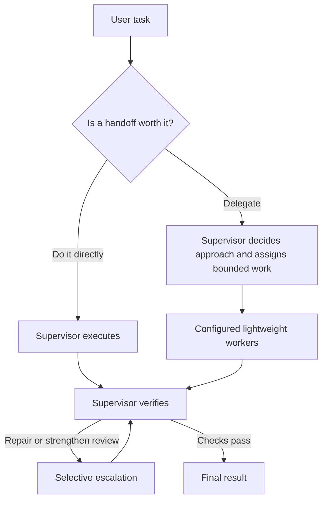

# elegantly-delegated

Let a frontier model make the hard decisions and give cheaper models work they can reliably finish. elegantly-delegated is an Agent Skill for coding agents that decides when a handoff is worth making, sets boundaries for each worker, and keeps verification with the supervisor. The project is designed to improve verified quality per dollar. Original performance results are pending.

## Quick start

Use Git and Node.js 22 or newer. Install from the workspace where you want the skill, or pass its path with `--project`. The following commands install a project-scoped skill and two optional Claude Code workers. `haiku` is an example model alias you can change.

```bash
git clone https://github.com/immobilesmile70/elegantly-delegated.git
cd /path/to/your/project
bash /path/to/elegantly-delegated/install.sh --target claude-code --worker-model haiku
```

On Windows, from PowerShell in your project directory:

```powershell
& 'C:\path\to\elegantly-delegated\install.ps1' --target claude-code --worker-model haiku
```

Use `--list` to see targets, `--dry-run` to preview changes, `--global` for user scope, or `--target codex,antigravity` to install the skill for multiple harnesses. You can run `node /path/to/elegantly-delegated/scripts/install.mjs` with the same options. Bash also works from WSL when Node and the harness run inside WSL.

To install the skill through the Agent Skills CLI:

```bash
npx skills add immobilesmile70/elegantly-delegated --skill elegantly-delegated
```

The standard skills installer lets you select agents and installs the skill only. Use the repository installer for packaged workers and the documented Antigravity App/CLI paths. [Installation, updates, and model configuration](docs/configuration.md)

## Use it

### Codex routing and verification

The installed skill guides native workers inside Codex. The checkout also provides an explicit read-only CLI router using your existing ChatGPT sign-in. It selects a model for each independent task, keeps simple requests to one turn, and retries eligible failures with a compatible catalog candidate. The CLI router can return proposed edits and read local files. Apply and verify changes through the supervising Codex session or native implementation workers.

This checkout already includes the Codex skill. Run the commands below from the root of this checkout. To install the skill in another project, replace `../your-coding-project` with the path to that project.

```powershell
node scripts/install.mjs --target codex --project "../your-coding-project"
node scripts/codex-route.mjs models
node scripts/verify-codex.mjs
node --test tests/*.test.mjs
node scripts/codex-route.mjs python --module yaml
node scripts/codex-route.mjs python --module yaml --script tests/check_configs.py
codex.cmd login status
node scripts/codex-route.mjs run 'Draft a concise README paragraph describing the current installer.'
node benchmarks/run-codex.mjs --run
```

The Windows launcher also accepts `powershell.exe -NoProfile -ExecutionPolicy Bypass -File .\install.ps1 --codex-route models`. The Git Bash equivalent is `bash ./install.sh --codex-route models`. To generate native profiles, add `--worker-model MODEL_ID` to the installer command using an ID confirmed for your session. Project installation retains backups of managed files it replaces under `.elegantly-delegated/backups/`. A global refresh is a separate install.

The router classifies architecture, planning, and debugging as complex. Other prompts default to routine. Use `--tier routine` or `--tier complex` to correct an ambiguous classification. `models` displays candidates from the bundled catalog without authenticating. Actual execution discovers the CLI catalog after sign-in. Catalog membership alone does not guarantee entitlement.

```text
node scripts/codex-route.mjs batch ./prompts.json --config ./routing.json --cwd ./project
```

`prompts.json` is an array of independent prompt strings. Defaults are two attempts per task, two concurrent tasks, at most four tasks per batch, 40 seconds per attempt, 60 seconds across the batch, and a 35,000 observed-token threshold. Override them with `maxAttempts`, `maxParallel`, `maxTasks`, `attemptTimeoutMs`, `timeoutMs`, and `maxObservedTokens`. Optional `routine` and `complex` arrays set ordered model preferences filtered through the catalog. The token threshold prevents new attempts after observed usage reaches it. In-flight turns and attempts without usage still require separate accounting.

Router answers go to stdout. JSON diagnostics and separate supervisor and worker usage summaries go to stderr. Counters include cached input and reasoning where the CLI reports them. The runner uses read-only sandboxing, disables native agent spawning and optional integration features for its turns, and stops on sign-in, permission, or subscription quota failures. Use it with a trusted local checkout. The technical verification steps and remaining gaps are in the [audit report](PLUGIN_TEST_REPORT.md) and [benchmark report](BENCHMARK_REPORT.md).

Set `ED_PYTHON` to an absolute interpreter path if Windows discovery misses your installation. The Python command distinguishes a missing interpreter from a failed dependency import and can run an explicitly supplied local script through the verified interpreter. Use a trusted script. Dependency checks use an isolated import probe, so install project dependencies in the selected environment.

Example prompt for a coding agent:

> Add JSON export to the issue list. Keep the existing CSV export behavior. Run the export tests and check that the empty-list response still works.

The supervisor can settle the output format and compatibility decisions, then assign a bounded change or verification pass to a configured worker. It can also finish the task directly if briefing, review, and integration would cost more than the handoff saves.

Harnesses can load the skill automatically when the prompt matches its description. To request it explicitly, use `/elegantly-delegated` in Claude Code or Antigravity, select `$elegantly-delegated` in Codex, or ask OpenCode to use the skill by name.



## Harnesses

| Primary experimental target | Packaged integration | Model control |
| --- | --- | --- |
| [Claude Code](docs/configuration.md#claude-code) | Skill and optional native workers | Claude alias or model ID |
| [Google Antigravity](docs/configuration.md#google-antigravity) | Skill and optional native workers for the current App and CLI | Documented `flash` or `pro` tier |
| [OpenAI Codex](docs/configuration.md#openai-codex) | Skill and optional standalone TOML worker profiles | Model ID within the parent provider |
| [OpenCode](docs/configuration.md#opencode) | Skill and optional OpenCode V2 workers | Connected `provider/model` with optional variant |

Additional installers cover Cursor and GitHub Copilot CLI with optional workers, plus skill installation for Gemini CLI, Pi, Cline, Kilo Code, Augment Code, Amp, and Qwen Code. The compatibility matrix covers native controls, provider selection, evidence, and manual paths. [Compatibility matrix](docs/compatibility.md)

## Research and evaluation

Prior work on routing and small-model collaboration motivates testing this approach. Task structure and coordination overhead can change the outcome, and skill effectiveness varies by task. The project evaluates its own policy using identical coding tasks with and without the skill. [Research notes](docs/research.md) · [Evaluation methodology](benchmarks/methodology.md)

The [benchmark report](BENCHMARK_REPORT.md) records live Work and standalone CLI comparisons, including answer correctness, token counters, and the limits of subscription credit attribution. Start with [test.md](test.md) and use [the results template](benchmarks/results/README.md) to record additional evidence.

Delegation can slow down small or tightly coupled changes, and a worker with insufficient capability may create more review and rework. Some harnesses inherit the supervisor's model or report only the requested tier. The skill uses model controls when available and treats runtime identity and cost as evidence to collect.

## Contributing and license

See [CONTRIBUTING.md](CONTRIBUTING.md) for infrastructure checks, compatibility updates, and how to submit reproducible results. The repository has no license yet. The maintainer's choice is pending before an open-source release can grant reuse rights.
